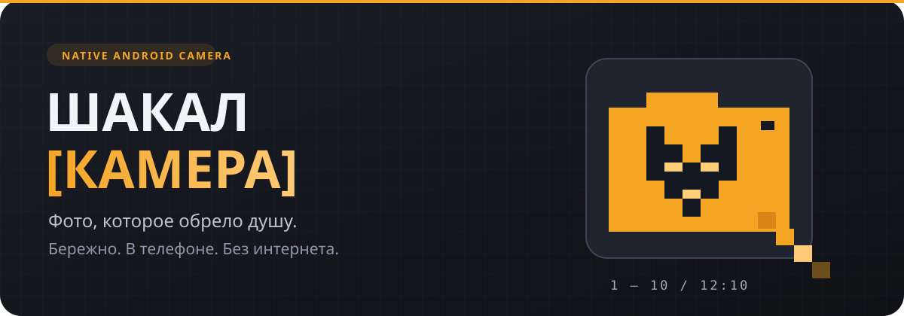
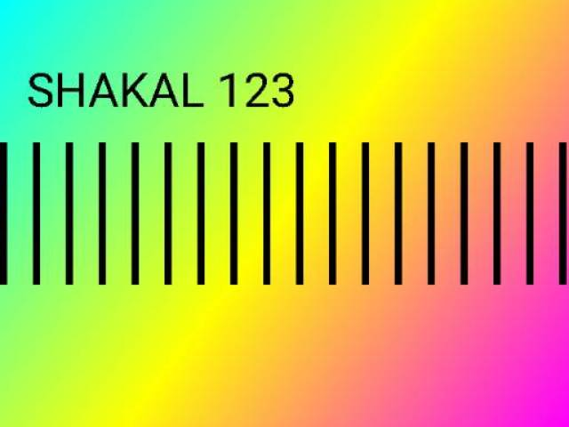
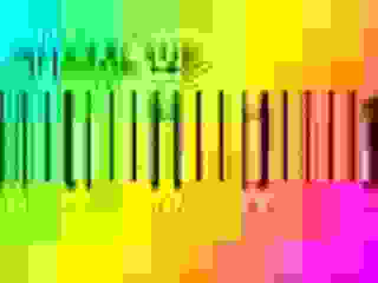

<div align="center">



**Нативная Android-камера с благородным мылом и аутентичными JPEG-артефактами.**

[](docs/INSTALL.md)
[](docs/DEVELOPMENT.md)
[](https://github.com/ChrysNeb/ShakalCamera/actions/workflows/android.yml)
[](#приватность)
[](TESTING.md)

### [↓ Скачать APK](https://github.com/ChrysNeb/ShakalCamera/releases/tag/v1.0.2) · [Установка](docs/INSTALL.md) · [Как собрать](docs/DEVELOPMENT.md) · [Страница проекта](https://ChrysNeb.github.io/ShakalCamera/)

Без аккаунтов. Без водяных знаков. Без интернета.

</div>

---

## Снимай сразу с характером

**Новое в 1.0.2:** живой фильтр теперь работает на GPU. Вместо редких Bitmap-снимков и JPEG-проходов — поток CameraX с целью до 30 кадров/с; на слабых устройствах темп адаптируется до 20/15. Превью ограничено примерно 640×480, а качество сохраняемого фото и намеренно рваный FPS видео не меняются. Скорость на реальных моделях ещё требует замера.

«Шакал Камера» превращает обычную съёмку в эстетику пятидесяти пересылок: тёплые квадраты, мягкие края, цвета с историей. Внутри настоящая Android-камера **CameraX / Camera2**, а не сайт в оболочке.

| 📷 Фото | 🎬 Видео | 🐺 Высокое искусство |
| --- | --- | --- |
| 1–10 шакалов, многократный JPEG, насыщенность и ореолы | Два поколения H.264, низкий битрейт, редкие кадры и шлейфы | Отдельный 12/10: чёткие пиксели и ограниченная палитра |
| Paint / Nearest / Чистый | Телефонная полоса, bitcrush, тремоло и паузы | Фото в PNG, видео в MP4 |

- **Снимай:** передняя / задняя камера, фокус касанием, свет и зум.
- **Смотри:** переключаемый облегчённый фильтр в видоискателе, на GPU, с адаптивным темпом до 30 кадров/с.
- **Сравнивай:** оригинал и результат, импорт из галереи, «Ещё шакальнее».
- **Делись:** сохранение в системную галерею и отправка через меню Android.

### Новое в 1.0.1

Видео стало похоже на запись старой камеры при слабом свете: несколько секунд нормального темпа (до 20 новых кадров/с), нерегулярные провалы примерно до 10 и короткие замирания около половины секунды. Расписание зависит от seed, яркости и изменения сцены. Это настоящие пропуски кадров в MP4, а не только эффект видоискателя.

Мягкий гостинг добавляет след предыдущего кадра. При быстром движении включается программная имитация rolling shutter; неподвижная картинка не изгибается. Настоящий аппаратный rolling shutter сенсора приложение не меняет.

## От винтажности до искусства

Ниже — **реальные результаты Android-фотоалгоритма** на синтетической тестовой картинке. Это примеры фильтра, не скриншоты телефона.

| 1/10 · лёгкая винтажность | 5/10 · классика жанра |
| :---: | :---: |
|  |  |
| **10/10 · шедевр пересылок** | **12/10 · высокое искусство** |
|  |  |

## Три шага

1. Скачай **ShakalCamera-1.0.2.apk** в [релизе](https://github.com/ChrysNeb/ShakalCamera/releases/tag/v1.0.2) и установи на **Android 8.0+**.
2. Разреши камеру, выбери **Фото** или **Видео**, уровень и нажми кнопку съёмки.
3. Сравни с оригиналом и нажми **Сохранить** или **Поделиться**.

Микрофон нужен только для видео со звуком. APK поддерживает ARM64, ARMv7, x86 и x86_64 — выбирать отдельный файл не требуется. [Подробная инструкция и решение проблем →](docs/INSTALL.md)

> **Первый Preview.** APK подписан debug-ключом и предназначен для прямой установки. Камера, микрофон и аппаратный видеокодек ещё не проверены на реальном телефоне. Локальная сборка и 22 теста прошли; это не подтверждённый тестами на устройствах магазинный релиз.

## Что внутри

| Слой | Реализация |
| --- | --- |
| Камера | CameraX с backend Camera2, lifecycle-aware preview и запись |
| Фото | Bitmap / Canvas, JPEG encode → decode, EXIF, ограничение 2048 px |
| Видео | Media3 Transformer + MediaCodec + OpenGL ES, два прохода |
| Звук | Потоковая PCM-обработка: полоса, sample-hold, bitcrush и дропауты |
| Галерея / отправка | MediaStore и FileProvider, системный выбор файла |
| Сборка | Java 17, Gradle Wrapper, Android SDK 35, GitHub Actions |

**Честно о видео:** это нативная адаптация эстетики веб-шакализатора. Здесь нет FFmpeg, повреждения битстрима, настоящего датамоша с удалением I-кадров или x264 zones. Шлейфы создаются GL-фильтром, а параметры кодирования Android может округлять. Итоговый файл остаётся обычным MP4 H.264 + AAC.

Лимиты: фото до 2048 px, результат видео до 480 px по длинной стороне; видео до 60 секунд, импорт до 200 МБ. Интерфейс рассчитан на портретное использование. Во время обработки приложение лучше держать открытым.

## Приватность

**В манифесте нет разрешения `INTERNET`.** Приложение не отправляет фото и видео на сервер, не подключается к сайтам и не использует аналитику.

Оригиналы из галереи не меняются. Временные файлы находятся в приватном кэше; файлы старше суток очищаются при следующем запуске. Результат появляется в общей галерее только по кнопке «Сохранить».

## Для разработчиков

```bash
git clone https://github.com/ChrysNeb/ShakalCamera.git
cd ShakalCamera
# Нужны JDK 17 и Android SDK; путь к SDK — в local.properties
sh ./gradlew assembleDebug testDebugUnitTest lintDebug
```

Windows: `gradlew.bat assembleDebug testDebugUnitTest lintDebug`.

APK: `app/build/outputs/apk/debug/app-debug.apk`. GitHub Actions собирает APK и публикует артефакт для каждого запуска. Для Google Play нужен собственный постоянный release-ключ.

- [Архитектура, таблицы и сборка](docs/DEVELOPMENT.md)
- [Что проверено и что ещё не проверено](TESTING.md)
- [Изменения](CHANGELOG.md)
- [Сообщить об ошибке](https://github.com/ChrysNeb/ShakalCamera/issues/new/choose)

Таблицы и принципы обработки перенесены из фото- и видео-шакализаторов. Веб-проекты не нужны ни при сборке, ни при работе приложения.

---

<div align="center">

**Шакалы — это эстетика. Бережём каждый артефакт.**

[Хаб](https://shakalizator.space) · [Фото](https://pic.shakalizator.space) · [Видео](https://vid.shakalizator.space)

</div>
